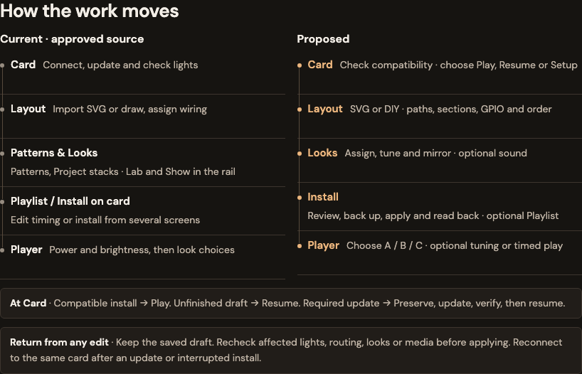

# Owner journey — start here

Reading order and status for every document about the Lightweaver owner journey.
Checked 2026-11-19 against `origin/main` at `1879bb30`. When two documents disagree,
the higher one in the reading order wins.

## The flow in one picture

- **Live in Studio today** (`lightweaver/src/v3/app.jsx:161`): Card · Layout ·
  Patterns · Lab · Playlist · Show, plus Projects in the top bar.
- **Proposed 2026-11-17, not built or approved**: Card · Layout · Looks · Install ·
  Player.
- **At Card**: a compatible install goes to Play. An unfinished draft goes to
  Resume. A required update follows preserve → update → verify → resume.
- **Returning from any edit**: keep the saved draft, recheck what the edit
  affected, and reconnect to the same card after an update or an interrupted
  install.

The 2026-11-17 documents were copied in from `~/Documents/Lightweaver Review/2026-11-17/`.
Some of their evidence links (`~/.codex/visualizations/…`, the full rendered board and its
logs) point at files on Adrian's Mac and are not in the repo. The full visual board, with
current vs proposed screenshots for every screen, is at
`~/Documents/Lightweaver Review/2026-11-17/flow-review/index.html`.

## Reading order

| # | Document | Status | Read it for |
|---|---|---|---|
| 1 | [owner-workflow.md](owner-workflow.md) | **Authority** (2026-11-17, contains Adrian's corrections) | The workflow in use order, arrival and resume, the change-and-return map, scope |
| 2 | [flow-visual-review.md](flow-visual-review.md) + [the board](flow-review/board-flow.png) | Current **proposal**, not approved | Proposed screens, names and consolidation |
| 3 | [2026-11-17-owner-workflow-audit.md](2026-11-17-owner-workflow-audit.md) | Current evidence (baseline `a73e56e1`) | Observed friction, missing steps, risks |
| 4 | [flow-review/function-inventory.md](flow-review/function-inventory.md) | Current | Every function and where it lives |
| 5 | [ui-release-2026-11-17.md](ui-release-2026-11-17.md) | Current | What shipped on Nov 17–18, and what is parked (the relative-tuning and default-startup firmware is in `firmware-queue`, not compiled in) |
| 6 | [parallel-delivery-2026-11-17.md](parallel-delivery-2026-11-17.md), [integration-2026-11-17/](integration-2026-11-17/README.md) | Current | What is owned, parked, or was integrated |
| 7 | [`CLAUDE.md`](../../CLAUDE.md) | Current | ESP32-only runtime, no Pi, shipment vocabulary |
| 8 | [`THINKING.md`](../../THINKING.md), 2026-09-11 onward | Partly stale | Still holds: no numbered ladder, every fact editable from any step, one owner per question. Overridden: Layout is now central, not optional |
| 9 | [`docs/card-state-matrix.md`](../card-state-matrix.md) | Current test contract | Every card state the journey must survive (connects, heals itself, a clicked pattern plays) |
| 10 | [first-action-manager.md](first-action-manager.md) | Partly stale | Its arrival principle (detect, then show the next step). Its "phase" wording is old |
| 11 | [`DESIGN.md`](../../DESIGN.md) | Current | Visual tokens only |
| 12 | [`docs/ux/2026-09-09-u2-patterns-playlist-critique.md`](../ux/2026-09-09-u2-patterns-playlist-critique.md) | Historical | Its "one status, one vocabulary" test is still valid. The screens it describes have changed |

## Past defects — use to check for regressions

These are history, not intent. Each records a real failure and states whether it
was fixed at the time.

- [`bench-sessions/2026-11-05-…-usb-wifi-reconnect.md`](../bench-sessions/2026-11-05-lw-40402bad4f7c-usb-wifi-reconnect.md): reconnect stalls, `lightweaver.local` unresolved (newest)
- [`bench-sessions/2026-09-27-…-usb-connection.md`](../bench-sessions/2026-09-27-lw-b0fe81f61b44-usb-connection.md): USB connection blocked
- [`bench-sessions/2026-09-08-round2-intake.md`](../bench-sessions/2026-09-08-round2-intake.md): F16–F24, including lights off while Studio says Connected
- [`bench-sessions/2026-09-05-step-four-to-patterns.md`](../bench-sessions/2026-09-05-step-four-to-patterns.md): the handoff into Patterns failed
- [`discovery-flow-findings-2026-08-06.md`](../discovery-flow-findings-2026-08-06.md): Find My Strips dead ends
- [acceptance-ledger.md](acceptance-ledger.md): J01–J14 proof at `bd3c61f8` (2026-09-07). Its statuses are no longer current

## Superseded — do not use as intent

- `PRODUCT.md`, user section: describes a desktop operator using WLED/Art-Net. Wrong for the ESP32-only plan; only its brand section still holds.
- `branded-installation-ui.md`: WLED/Pi era (says so itself).
- `docs/roadmap.md`: last updated 2026-07-21, before Looks and Player.
- `docs/plans/2026-09-05-unified-card-journey.md`: the B0–B5 setup ladder, replaced on 2026-09-11.
- `docs/wiring-sizing-ui-redesign.md`, `docs/layout-redesign-plan.md`: July Wire/Size/Draw modes.
- `todo/plans/software-first-card-flow.md`: 2026-08-11 baseline.

## Words on screen — decided 2026-11-19

[GLOSSARY.md](GLOSSARY.md) is the one list: **Save to card**, **Look**, the
**Looks** screen, **Connect**, **Output** (GPIO only as a detail). A test holds
Studio to it, and the 184 rejected words still on screen can only go down. This
settles the naming half of the old contradictions 1 and 2. Still open: whether
Show becomes Player, and where Playlist sits.

## Open contradictions — undecided

1. **Step order.** `TODO.md`: Connect → Layout → Looks → Playlist → Install.
   Proposal: Card → Layout → Looks → Install (with Playlist inside it) → Player.
   `owner-workflow.md`: nine stages from Connect to Maintain, explicitly "not a
   forced nine-page wizard".
2. **Folds.** `owner-workflow.md` says no accordions. Card Home (2026-09-11)
   still uses folds.
