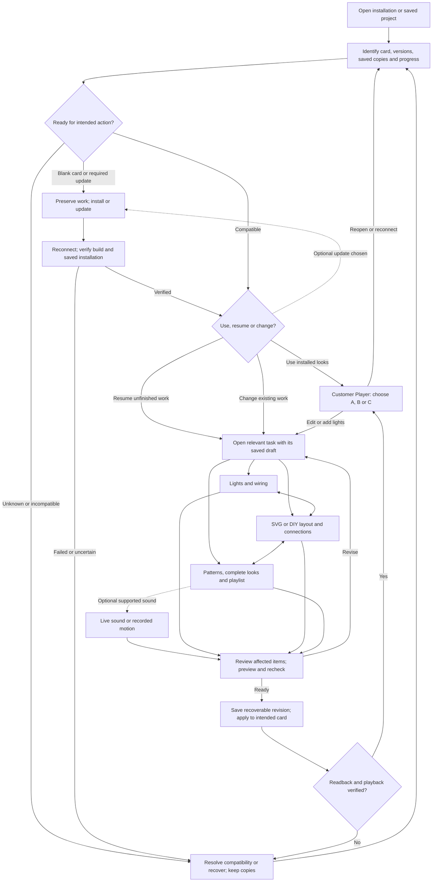

# Lightweaver — ordered workflow, scope and simplification plan

Updated 2026-11-17 with Adrian’s corrections. Owner: primary manager.
Status: initial parallel changes integrated locally; final combined checks recorded
in [integration review](integration-2026-11-17/README.md). Physical acceptance remains
blocked independently. Nothing deployed. Source baseline: `a73e56e1` plus the
uncommitted candidate. The flow below distinguishes intended behavior from proof.

Supporting findings: [full-app inventory and evidence](2026-11-17-owner-workflow-audit.md).
Task status remains in `LIGHTWEAVER_WORKBOARD.md`.

## Outcome

Make the installation visually, understand how every part connects, create
complete lighting looks, then give customers an easy way to select A, B or C.
Keep all useful existing capabilities. Simplify the presentation and connections
between tasks before assuming features should be removed.

A **pattern** is an individual effect. A **look** is a named complete arrangement
of patterns, section assignments, supported symmetry and tuning, plus sound
behavior where the selected playback method supports it. A **project** contains
the artwork setup and its saved looks. A **playlist** is an optional ordered,
timed selection of looks. These are proposed user-facing meanings; stored formats
and interfaces remain compatible.

## Confirmed customer control and startup rules — 2026-11-17

Adrian selected both rules directly:

- Customer adjustments apply to the complete look while preserving differences
  between sections: relative brightness/speed and hue offset against saved bases.
- Power-on starts the configured default look with its saved settings. It does
  not overlay another look's last live zone state or resume unsaved adjustments.

Implementation preserves legacy absolute-control meanings, gates new behavior
by card capability and keeps live/explicit-save scope consistent. Unsaved modifiers
are temporary to the active look; selecting/reselecting loads the selected look's
saved state. Recordings retain supported brightness control; unsupported speed/hue
must be explained. Saved settings require exact look/revision readback. These are
chosen behaviors; physical proof and a signed release remain future requirements.

## Consolidated flowchart

This is the intended behavior, not a diagram claiming every path is proven.
“Resume” uses separate task states, not one setup-complete flag. Optional updates
must not interrupt compatible playback. Unverified compatibility needs inspection,
not an assumption that the installation works or requires an update.

Drafts must survive navigation, leaving and reopening at any task. The save/apply
box does not imply drafts are saved only at the end. Offline design remains
available without a connected card; card-specific checks wait for connection.
Hardware changes can invalidate old playback: preserving a prior revision does
not make it safe to drive newly rewired lights with the old mapping.

## What exists, what is missing, and what remains unverified

| Area | Implemented locally | Still missing or unverified |
| --- | --- | --- |
| Connect/update | Card arrival distinguishes compatible, required update and unverified; preserves draft; post-update notice tied to exact card/build/project | Actual saved installation and LEDs after update need bench proof |
| Resume setup | Card Home resumes unfinished layout separately from playable installed looks | A comprehensive persisted impact map for every possible setup task remains future work |
| Layout | Grouped SVG/Draw/Shapes; selected GPIO/ranges/direction; import replacement confirmation; split preview, symmetry guard and Undo | Real two-GPIO mapping, same-GPIO motion and rewiring checks await safe bench access |
| Complete looks | Canonical section assignments, legacy reopen repair, per-look mirror targets and exact playlist Undo | Physical A/B/C recall remains unverified |
| Customer use | Compact looks-first Player; relative whole-look tuning and configured-default startup; capability-gated older cards | New firmware compiles and host/browser tests pass; power-cycle and output proof remain blocked |
| Safe back/forward | Draft/reload, review-before-save, exact Undo cues, split guards and card identity checks | Every hardware alteration is not automatically proven safe; affected wiring still needs physical recheck |
| Save/recovery | Project round-trip and card-package checks; validated separate Voices export/import | A single combined project-plus-Voices archive is not implemented; cross-version physical restore remains unverified |
| Sound | Clear browser live, recorded and native distinctions; strict Voices portability | Native standalone listening remains unfinished and does not gate ordinary looks |
| UI structure | Compact Layout/Playlist/Player; spatial Piece preview; selected-section focus; usable desktop catalogue | Global Studio phone toolbar/footer density and consistent “look” terminology still need a separate review |

See the integration record for exact test scope and known harness intermittency.
Simulated card responses and host tests are not physical LED evidence.

## The owner's workflow, in use order

| Step | Owner/customer action | What must be understandable and preserved |
| --- | --- | --- |
| 1. Connect and prepare | Identify the ESP32 card; flash a blank card or update when needed; complete USB/Wi-Fi handoff. | Which card is connected; existing project versus new work; no unnecessary repeat setup or accidental overwrite. |
| 2. Establish real lights | Find used GPIOs, count LEDs, check strip type/colour order, first/last LEDs, direction and supply/brightness limits. | Named runs match the actual lights. Keep all safety and identity checks. |
| 3. Build the visual layout | Import SVG/vector artwork, draw DIY paths, or use shapes. Review imported geometry; choose which artwork outlines actually carry LEDs. Set scale/density and reconcile counts. | Layout is central to this workflow, even if not technically required by firmware. All relevant artwork and paths must be visible and editable. |
| 4. Connect and arrange | Place/name strips and sections, show connections, GPIO/ranges, cuts/jumps, start/direction, order and symmetry sides. | Physical wiring order, visual animation flow and later playlist order are separate. Selecting a section connects the drawing, its physical route and its pattern assignment. |
| 5. Compose a complete look | Assign effects to sections. One GPIO can contain separately controlled ranges; one effect can span several GPIOs. Choose mirroring/folds/kaleidoscope and tune speed/colour/brightness. | Whole-artwork preview shows the intended combined result and selected target. Same-LED layering is a separate capability, not assumed from multiple sections per GPIO. |
| 6. Add supported sound if wanted | Choose live sound, recorded motion, or ordinary native playback; tune response when supported. | Explain input, response and execution requirements. Sound off remains a complete path; unfinished sound work never gates core development. |
| 7. Save and prepare customer choices | Save complete looks A/B/C, arrange an optional playlist, choose startup behavior, save project and backup, install the chosen content and verify readback. | All section settings belong to the correct look. Distinguish saved draft, portable backup, installed content and currently playing state. |
| 8. Customer use | Hand over a paired Player link/local fallback. Customer opens their installation and selects A, B or C; optionally adjusts brightness, turns lights off/on or runs the playlist. | One choice recalls the complete connected arrangement. Current look is obvious. No need to understand GPIOs, Lab or setup. Temporary versus saved adjustments are clear. |
| 9. Maintain and recover | Reconnect, restart, reopen, change an installation, restore a backup, or recover from the card. | Preserve usable work; flag looks affected by layout changes; define resume-last versus default-on-boot; explain partial recovery honestly. |

Steps 2–4 may iterate as the artwork and installation develop. This is a logical
journey, not a forced nine-page wizard. Drawing offline remains possible, and
returning users skip completed setup. Daily use is **open → choose A/B/C → enjoy**.
Physical verification is our acceptance responsibility, not extra routine work
for the customer.

## Arrival, compatibility and resumable progress

Correction to the simple new/existing flow: an existing installation may be
partially configured, out of date, incompatible with a requested feature, or
holding a different saved revision. Arrival must inspect these independently.
This is proposed behavior to verify, not a claim that it is all implemented.

1. Identify the card and read its actual installed project and firmware build.
   Identify the Studio build and saved-project format/capability requirements.
   Reconcile browser/file/card copies without silently choosing the newest or
   overwriting a different draft.
2. Answer two separate questions: **Is a newer release available?** and **Can this
   project and requested action work with the current versions?** Distinguish
   compatible, update needed for this action, incompatible, and unverified.
   Newest does not automatically mean compatible; older does not mean unusable.
3. Inspect completion and evidence for each task. Use not started, in progress,
   verified, needs recheck, or unknown—not a single setup-complete flag. Resume
   the next relevant unfinished task; keep completed tasks editable. A customer
   can keep playing a valid installation while optional authoring remains unfinished.
4. When updating is needed or chosen, explain which component changes, preserve
   recoverable project/settings/media and unfinished drafts, and use the existing
   supported USB or Wi-Fi update path. Explain backup gaps before proceeding.
5. After update, reconnect to the same card, verify its actual build, read back
   the saved installation and check required playback capabilities. Prove the
   previously saved looks still work; a successful flash alone is insufficient.
   If compatibility or restoration fails, preserve the previous recoverable state
   and offer the supported recovery route rather than restarting setup blindly.
6. Invalidate only evidence affected by a change. Geometry edits may need mapping
   and preview checks; GPIO/count changes need physical and assignment checks;
   firmware changes need relevant runtime checks. Do not automatically erase all
   completed work or assume all previous evidence remains valid.

| Arrival example | Appropriate next action | Preserve |
| --- | --- | --- |
| Lights verified; no artwork imported/drawn | Build visual layout | GPIOs, counts, colour/direction checks |
| Artwork partly drawn; wiring unfinished | Resume mapping/wiring | Geometry and draft edits |
| Looks saved; card installation not verified | Verify/install the intended saved revision | Saved looks and distinct card/browser copies |
| Working installation; optional update available | Continue using; offer update separately | Current playback and work in progress |
| Requested feature needs newer firmware | Explain requirement and prepare preserving update | Existing supported playback and project |
| Updated card; saved project compatibility unknown | Verify saved installation and looks | Backups and incomplete task state |
| Browser and card hold different projects | Identify both and choose the intended work | Both copies; no silent replacement |

The flow board therefore needs an arrival/state map alongside its ideal journey.
Acceptance must include mid-setup exit/reopen, interrupted update, older saved
project on newer software, version skew between Studio and card, and post-update
look recall. Unsupported migration work remains separately scoped.

## Change-and-return map: navigating and editing safely

The journey is a network of editable tasks, not a one-way setup sequence.
Navigation and mutation are separate: opening another screen must not install a
draft, lose selection/edits, or change the playing installation. These are target
contracts to verify against code and real behavior, not guarantees already proven.

Every change needs an impact summary identifying affected sections, looks,
playlists, recordings, previews and card configuration. Preserve stable identities
where possible; never silently retarget saved assignments by row position.

| Return/edit | Work to preserve | Checks before applying to card |
| --- | --- | --- |
| Navigate among Layout, Patterns, Lab and Playlist | Project, draft, selected target and intended return location | No unintended playback/write; unsaved work remains available |
| Rename a strip, section or look | Identity, assignments and references | Labels agree across screens; no remapping caused by name change |
| Reorder list rows for organization | Physical wiring and playback order unless explicitly selected | State what this order controls; no hidden wiring mutation |
| Change playlist order/durations | Layout and look contents | Membership, timing, transition and startup consequences |
| Tune a pattern or per-look symmetry | Other looks and physical layout | Correct scope, complete-look save/recall and preview |
| Move/resize visual geometry | GPIO/counts unless explicitly changing physical sizing | Explain whether scale/density changes counts; recheck spatial effects and recordings |
| Add LEDs, a strip or another GPIO | Existing section IDs, assignments and working installation | Power/capacity, count, routing, end markers, preview and affected looks/media |
| Change physical count, GPIO, direction or chain order | Editable geometry and recoverable prior configuration | Physical identification, range boundaries, section mapping and full-look targeting |
| Split/merge/delete a section or strip | Prior recoverable version and unaffected sections | Explicit treatment of orphaned look/playlist references; no silent reassignment |
| Change symmetry sides or animation flow order | Physical wiring unless explicitly edited | Per-look mirror behavior, continuous flow, preview and recording freshness |
| Replace SVG/artwork | Recoverable earlier layout and saved looks | Explain replace versus merge; resolve/recheck affected paths and assignments |
| Switch project/card or restore a copy | Both source and destination work | Identity/revision comparison, draft handling and intended destination |
| Update firmware/software | Saved project, assets, drafts and progress | Version compatibility, readback, affected runtime checks and saved-look recall |

“Order” must always name its meaning: display order, physical chain order,
animation flow order, or playlist order. If an existing control couples these,
explain and verify that coupling rather than pretending they are independent.

The safe revision loop is **open current work → edit a draft → inspect affected
items → preview/test → save a recoverable revision → apply intended changes →
read back/verify → use**. Preserve the known working installation until a deliberate
apply or clearly identified temporary live test. A live test needs an explicit
stop/restore path and must not be presented as a permanent save.

Back navigation, undo, restoring a project revision and recovering card firmware
are different operations. Back returns to context; undo reverses supported edits;
restoring a revision recovers saved content; card recovery follows supported
hardware/update paths. Do not imply that browser undo reverses physical wiring or
an already-installed card change.

Additional acceptance examples: add a strip to an installed A/B/C project;
change chain order without losing assignments; rename versus reorder; split/delete
a section referenced by looks; revise symmetry; cancel a temporary test; navigate
away and return with unsaved edits; fail during apply and retain a recoverable
state. Recheck only affected evidence, but never mark untested dependencies valid.

## Scope and boundaries

In scope: existing active Studio, layout/preview, complete-look composition,
customer Player and card-local fallback, navigation, terminology, presentation,
save/install clarity, and demonstrated defects preventing the agreed journey.
Include SVG and DIY drawing; preserve Mapper, Lab, recordings, support and
manufacturing jobs where they serve distinct purposes.

Do not expand this into a new backend, storage migration, new runtime, Pi revival,
or standalone sound-engine implementation. Any such requirement is a separately
scoped decision. Firmware changes are justified only by an identified behavior
needed for the accepted flow, not by the desire to tidy the interface.

## How simplification decisions will be made

For each element record: **who uses it → what job it does → when needed → what
it depends on → what evidence protects it → proposed treatment**.

Use the smallest effective treatment:

| Treatment | When it helps | Rule |
| --- | --- | --- |
| Clearer name | Related concepts are confused | Use consistent words for effect, complete look, project and playlist. |
| Icon or icon + short label | Familiar repeated operations such as zoom, fit, undo, play | Keep accessible names, tooltips and usable hit areas. Unfamiliar destinations need labels; the Projects breadcrumb/icon confusion demonstrates why. |
| Smaller visual button | Secondary actions compete with primary work | Reduce visual emphasis/padding without sacrificing touch usability. |
| Better grouping | Controls act on the same selected object | Cluster assignment, symmetry and tuning around that section/look. Avoid repeated headings and nested boxes. |
| Background / spacing / differentiation | User cannot tell preview, selection, editable controls and status apart | Use purposeful surfaces and contrast; do not rely on colour alone or add decorative panels everywhere. |
| Simple connectors / highlighting | Relationships between artwork, LED runs and assignments are unclear | Highlight relevant connections/paths on selection; label physical versus logical relations; avoid crossing-wire noise. |
| Better layout | Main action or preview is displaced | Prioritize artwork and A/B/C choices; put compact controls beside their context. Check desktop and phone with real/long labels. |
| Integrate duplicate access | Several entrances perform the same job | Consolidate project transfer in Projects, for example, while preserving artwork SVG import in Layout. |
| Move to a focused view | Infrequent specialist work overwhelms ordinary use | Keep reachable through ordinary navigation; preserve Lab, Mapper, diagnostics and Support purposes. |
| Remove | The job is obsolete or fully served elsewhere | Prove that first. No function is currently approved for outright deletion. |

No accordions, expandable cards or details/summary disclosures. Do not substitute
mysterious icons for clear actions, or shrink everything uniformly. Before visual
approval, show current/proposed comparisons inline with the same content and
viewport, including narrow/wrapped states, with a recommendation.

## Ordered work plan — behavior first, UI second

1. **Agree the rules before designing screens.** Define what a complete look
   owns versus installation settings, temporary customer adjustments and playlist
   settings. Define the four orders (display, physical wiring, animation flow,
   playlist), startup behavior, and version/project compatibility meanings.
   Deliverable: concise ownership/state table with explicit unresolved decisions.
2. **Prove the baseline and find actual failures.** Use one representative
   artwork, at least two GPIOs and A/B/C looks. Check existing source/tests first;
   then run targeted checks for update preservation, unfinished-setup resume,
   complete recall and back/forward editing. Inspect available hardware before
   requesting physical actions. Distinguish absent functionality from untested
   behavior. Deliverable: evidence-backed gap list, not another broad audit.
3. **Establish safe change and recovery behavior.** Trace dependencies when
   adding lights, changing order/counts, splitting/deleting sections or replacing
   artwork. Verify drafts, stable references, affected-item checks, temporary-test
   restoration and failures during apply. Repair confirmed blockers within the
   agreed scope before cosmetic work. New storage architecture or migrations
   require separate scope review.
4. **Approve the screen structure and simplification treatment.** Use the proven
   rules and purpose inventory. Show matched current/proposed comparisons for
   the artwork editor, complete-look editing and customer Player. Use icons,
   compact controls, connectors, backgrounds, differentiation and clustering where
   clearer. Keep unfamiliar actions labeled and specialist tools reachable.
5. **Implement coherent journeys.** First Layout/connection/preview continuity,
   then complete-look save/install clarity, then immediate customer A/B/C use and
   handoff. Consolidate project transfers, status and specialist navigation while
   preserving each function's job. Independent work can proceed in parallel once
   shared contracts and file ownership are clear. Sound stays a separate lane.
6. **Verify the integrated result.** Focused checks during work, then one full
   relevant verification. Inspect actual desktop/phone states, including long
   labels and unfinished work. Prove real A→B→C→A, mirroring, updates, restart,
   added/reordered lights, offline/reconnect and clean restore. Record simulation,
   card readback and observed physical output separately.
7. **Publish only when authorized.** Present working behavior and limits, then
   hand the exact approved candidate to durable background publishing. A running
   release is not shipped.

**First work to start:** steps 1–2, followed by confirmed behavior blockers in
step 3. Do not begin a general UI redesign while these dependencies are unclear.
This plan is scoped; it does not mean completing every optional feature first.

Manager owns the integrated result and the workboard. Assign only independent
work with clear file ownership and shared contracts; use Astra for a bounded,
evidence-backed difficult question when needed. Do not spend agents monitoring
unchanged releases or duplicate review.

## Parallel delivery plan

**Active dispatch:** Adrian authorized six separate Sol/medium chats. See
[ownership and resumption register](parallel-delivery-2026-11-17.md). These split
readiness from saved-look reliability and add independent sound/UI-design work.
All six were confirmed running; no completed result is claimed yet.

Initial proposal (superseded by the authorized six-chat dispatch below): use three independent build owners plus the primary manager (four concurrent
agent slots in this session). Additional named workstreams are queued, not kept
running without a deliverable. This is the proposed dispatch structure, not a
claim that builds have started. Prefer managed subagents for current-session work;
create sidebar chats only when Adrian explicitly requests their creation.

### Shared kickoff, then parallel work

Before overlapping implementation, establish a compact contract: stable section
and look identity, meaning of each order, installed versus draft state, complete-
look contents, and the current project/transport interfaces. Use existing formats;
unresolved changes go to the manager. Source inspection and baseline tests can
run concurrently during this kickoff; do not wait for a full redesign spec.

| First-wave owner | Independent finished result | File boundary and dependencies |
| --- | --- | --- |
| A: Installation and saved-look reliability | Evidence-backed compatibility/resume/change matrix; bounded fixes for reproduced save/recall/recovery defects; focused tests | Own an explicit allowlist of commissioning, project save/readback/transfer and saved-look model/compiler helpers plus their tests. No Layout, Player or global shell edits. Freeze current interfaces for B/C; coordinate firmware changes separately. |
| B: Visual layout and authoring clarity | SVG/DIY editing, selected-section connections and preview made understandable; clearer controls without losing jobs; desktop/phone evidence | Layout components/hooks/styles and layout preview helpers only, with an exact allowlist. Consume existing project/section interfaces. Shared Pattern-screen preview integration waits for the next-wave owner. No global state/schema/compiler edits. |
| C: Customer daily use | Immediate complete-look A/B/C choices, clearer current look/adjustments, compact phone layout and reconnect feedback, with simulated tests/screens | ClientApp/client styles/model tests; preserve transport and card API contracts. Do not change shared customer-control semantics or firmware until A/manager resolves them. No Studio shell or layout edits. |
| Primary manager: UI organization and integration | One screen map, terminology/treatment decisions, matched current/proposed visual comparisons, integrated acceptance and workboard | Documentation/design artifacts and integration ownership. Global app shell, shared CSS/state/providers, route changes and firmware are reserved; assign implementation to one explicit owner when dependencies settle. Respect CLAUDE.md source ownership boundaries. |

Each dispatch needs the exact base revision, file allowlist, expected behavior,
proof and escalation boundaries. An agent encountering shared files proposes the
change to their owner rather than editing them. Tests that reuse fixtures also
need explicit ownership. Independent read-only inspection is permitted everywhere.

### Next wave as capacity becomes available

1. Complete-look editor and Playlist organization: one Studio owner handles
   `lw-pattern.jsx` and `lw-playlist.jsx` together, consuming stable layout/save
   contracts. This avoids splitting coupled complete-look behavior across workers.
2. Shared navigation, status, Projects and update/resume presentation: one Studio
   owner implements the manager's agreed screen map after reliability findings
   establish truthful state/action labels. Do not parallel-edit app.jsx/shared CSS.
3. Sound portability and execution labels: separate bounded owner; ordinary looks
   remain independently deliverable. Native listening stays out of scope.
4. Firmware defects, if reproduced: dedicated firmware owner with exact contracts;
   serialize real-card writes and tests. Missing bench access blocks physical proof,
   not unrelated layout/customer UI work.

UI organization starts immediately as design work and within isolated screens;
app-wide shell edits wait only for the shared decisions they actually depend on.
Do not postpone all visual progress until all reliability work is finished.

### Integration discipline

Integrate compatible completed increments in dependency order, not agent finish
order. Keep current interfaces stable or land the contract change with its consumers
as one coherent increment. Each owner runs focused checks; manager owns the combined
actual-screen review and one full relevant verification before authorized release.
Use the same representative artwork and A/B/C looks across streams. Preserve a
known-good baseline, compare results every 20 minutes, and stop adding parallelism
when integration becomes the bottleneck. No repeated broad review or CI polling.

## Sound work that must not block the core

- **Live Show:** browser audio analysis and frame streaming exist. Preserve modes,
  voices and tuning. Verify permissions, silence, stopping, background behavior and
  reconnect. Label “Live sound — keep Studio open.”
- **Recorded motion:** offline WAV analysis/baking exists. Verify media support,
  installation and restart. Label fixed recorded playback, not live listening.
- **Show composition portability:** composition currently lives separately from
  the normal project document in localStorage. Make its backup scope truthful;
  integrate portable saving as its own task rather than blocking normal looks.
- **Standalone live listening:** firmware recipe audio is currently bake-only.
  Treat card-native listening as separate unfinished work requiring its own input,
  persistence and rendering contract plus hardware proof.

A sound-dependent look cannot be claimed complete without its own proof, but that
must not hold up the layout, ordinary native looks or customer switching path.

## Current evidence and open proof

All active surface families were inventoried in source; representative local
Studio desktop/phone screens and the customer Player were inspected. In an
isolated simulated card session, A→B→C→A sent the expected complete-look IDs with
`syncZones:true` and updated the selected label. This does not prove physical
multi-zone playback, exact preview parity, sound, startup or recovery.

No feature removal, UI implementation, firmware write or deployment occurred.
The supporting audit records concrete findings, source anchors, screenshots,
coverage gaps and physical checks still needed. Historical test passes are not
borrowed as current evidence.
